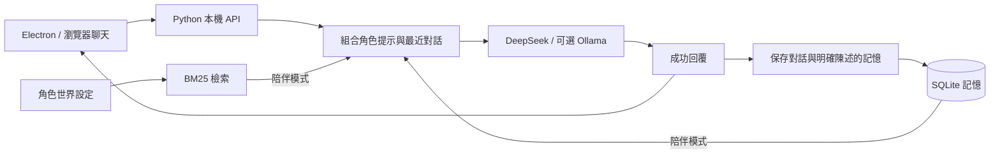

# 鯨日陪伴 · 小肥魚

**Whale Companion — a local Windows AI desktop pet with character memory.**

以 Electron 桌寵、Python 後端和 DeepSeek API 打造的 AI 角色陪伴工具，結合角色設定檢索與跨對話記憶，讓每次聊天能延續熟悉的角色與話題。

目前是可在 Windows 運行的原型。桌寵互動、聊天介面、記憶與評估流程已實作；**真實模型回覆品質與兩模式的效果比較尚未完成**。本專案沒有訓練 DeepSeek，也不是 DeepSeek 官方產品。

> 角色外觀及部分動畫程式碼來自 [surfpet](https://github.com/Mieksido/surfpet)，並非本專案原創美術。此原始碼版本不包含小肥魚圖片；啟動器會從固定的上游 release 下載供本機原型使用。來源與授權範圍見 [第三方聲明](THIRD_PARTY_NOTICES.md)。

## 可以做什麼

- **桌面陪伴**：透明置頂、拖動並記住位置、透明區域點擊穿透、系統匣找回、三種大小。
- **兩套造型**：小肥魚全身版 `feiyu-02` 與 Q 版 `feiyu-03`；共享同一角色記憶，支援眨眼、呼吸、摸頭及尾巴反應。
- **中文聊天**：雙擊角色開啟聊天；也可透過本機瀏覽器使用。DeepSeek 金鑰由 Python 後端保存及使用。
- **角色設定檢索**：BM25 從「潮汐小屋」世界設定找出最多三段相關資料；作者秘密不加入索引。
- **跨對話記憶**：SQLite 保存明確陳述的名字、偏好、目標；可查看、修改及刪除。成功生成後才寫入該輪對話和新記憶。
- **可比較的實驗**：基礎模式與陪伴模式使用相同模型參數；提供 20 個小肥魚情境、重複評估工具及人工評分規則。

動畫採用 **PixiJS 分層 PNG**，不是 Live2D。語音、螢幕理解、主動提醒、遊戲控制及向量檢索尚未實作。

## 快速開始（Windows）

需要 [Python 3.11+](https://www.python.org/downloads/windows/)、[Node.js 22.12+](https://nodejs.org/)（包含 npm）及首次安裝所需網絡。Python 後端只用標準函式庫，無需 `pip install`。建議放在一般使用者可寫入的資料夾。

1. Clone 此 repository，或下載 ZIP 並解壓縮。
2. 雙擊根目錄的 **`Start-Whale.cmd`**。
3. 首次啟動會下載指定的 surfpet 素材、執行 `npm ci`、安裝 Electron runtime，並建置動畫。完成後會顯示桌寵和聊天視窗。
4. 在聊天視窗右上角 **模型設定** 填入自己的 [DeepSeek API key](https://platform.deepseek.com/api_keys)。目前預設 `deepseek-flash`，介面可選 `deepseek-v4-pro`；模型須在帳戶中可用。
5. 選 **陪伴模式**，說「我叫阿晴。我喜歡烏龍茶。」；成功收到回覆後開啟新對話，再問「你記得我的名字嗎？」。

沒有 API key 仍可查看介面與桌寵動畫；聊天生成需要有效帳戶及可用額度。固定歡迎語是介面文案，不代表模型已成功連線。

| 操作 | 效果 |
|---|---|
| 按住角色拖動 | 移動桌寵，保存位置 |
| 點頭部 / 雙擊角色 | 摸頭 / 開啟聊天 |
| 角色右鍵 / 系統匣右鍵 | 換裝、調整大小、隱藏、找回、退出 |
| 聊天左欄 | 切換造型、摸頭、搖尾巴 |
| 編輯記憶 / 清除資料 | 修正記憶 / 刪除目前訪客的記憶與對話 |

瀏覽器入口：[http://127.0.0.1:8765/](http://127.0.0.1:8765/)。瀏覽器與 Electron 使用不同訪客身分，不會自動共享記憶。關閉桌寵後 Python 後端會繼續運行，以支援網頁聊天。

## 專案結構

```text
.
├── README.md
├── THIRD_PARTY_NOTICES.md       # 引用、沿用範圍與第三方授權
├── .env.example                # 空白設定範本，沒有金鑰
├── Start-Whale.cmd              # Windows 一鍵啟動
├── backend/
│   ├── companion.py            # 模型適配、BM25、記憶、SQLite
│   └── server.py               # 本機 HTTP API 及靜態頁面
├── desktop/
│   ├── main.cjs                # Electron 視窗、系統匣、拖動及 IPC
│   ├── preload.cjs             # 桌寵橋接
│   ├── chat-preload.cjs        # 聊天橋接
│   ├── renderer.ts             # 改編自 surfpet 的互動渲染
│   ├── pet.html / pet.css
│   ├── vendor/                 # surfpet rig.ts 及完整上游 LICENSE
│   └── package*.json           # 固定 npm 依賴版本
├── web/
│   ├── feiyu/                  # 目前使用的中文聊天介面
│   └── mira/                   # 早期英文角色原型
├── content/
│   ├── feiyu/                  # 小肥魚人格及潮汐小屋設定
│   └── mira/                   # Mira 人格及世界設定
├── evaluation/
│   ├── scenarios/              # feiyu.json / mira.json
│   └── RUBRIC.md               # 比較條件、人工評分及報告規則
├── tests/                      # 不呼叫真實模型的 Python 測試
├── scripts/                    # PowerShell 啟動器及 Python 定位
├── tools/                      # 素材還原、評估、打包、可選 Ollama 安裝
└── docs/                       # 開發說明、來源分析及授權範圍
```

執行時另行產生 `data/`、`.runtime/`、`.work/`、`desktop/skins/`、`desktop/node_modules/`、`desktop/dist/`、`evaluation/results/` 及 `dist/`。這些資料不納入 Git；本機角色 icon 與網頁預覽圖也已排除。

## 系統如何運作



| 條件 | 基礎模式 Baseline | 陪伴模式 Enhanced |
|---|---|---|
| 角色提示、最近三輪、目前訊息 | ✓ | ✓ |
| 相同模型、temperature `0.4`、最多 `350` 輸出 token | ✓ | ✓ |
| 最多三段已知世界設定 | — | ✓ |
| 讀取及自動更新長期記憶 | — | ✓ |

這個比較測量「檢索 + 記憶」的合併效果，不能分別證明兩項機制的貢獻。檢索使用英文詞與中文重疊雙字詞，可能錯過同義詞、繁簡轉換及間接問法。

自動記憶目前支援「我叫…」「叫我…」「我喜歡…」「我的目標是…」及相應簡體、英文句型。這是明確陳述的規則提取，不是任意對話摘要；複雜說法可用記憶編輯器。

## 開發與驗證

以下 Python 指令都在 repository 根目錄執行。若 Windows 使用 `py`，可把 `python` 換成 `py -3`。

```powershell
# 基礎設施測試：不使用 API key，不產生模型費用
python -m unittest discover -s tests -v

# 還原本機素材；只跑網頁時亦需這一步取得預覽圖
python -m tools.setup_pet_assets

# 手動啟動後端；Ctrl+C 停止
python -m backend.server --character feiyu --port 8765
```

手動安裝 / 建置桌寵（後端須另行啟動）：

```powershell
cd desktop
npm ci
node node_modules/electron/install.js
npm run build
npm start
```

Electron 45 需明確執行 runtime 安裝指令。Windows sandbox 權限問題可改用根目錄啟動器，見 [開發與疑難排解](docs/DEVELOPMENT.md)。其他作業系統的桌寵行為尚未驗證。

## 評估

```powershell
# 僅檢查情境與請求數；不呼叫模型
python -m tools.evaluate --dry-run

# 真實模型測試：需要已配置的模型，DeepSeek 會產生 API 費用
python -m tools.evaluate --scenario F07 --repeats 1
python -m tools.evaluate --repeats 3
```

小肥魚完整評估為 **20 情境 × 2 模式 × 3 次 = 120 個受評回覆**，加上前置對話共 **162 次模型請求**；F07 單次記憶測試共 4 次請求。輸出包含設定與檔案雜湊、原始回覆、延遲、檢索記錄及空白人工評分表。

依 [評分規則](evaluation/RUBRIC.md) 評分；檢索命中不等於回答正確。18 項自動測試使用假模型，只證明程式行為，不能當作真實模型效果。真實模型品質與多螢幕 / DPI 行為仍待進一步驗證。

## 引用與本專案貢獻

| 來源 | 使用方式 | 本專案中的位置 |
|---|---|---|
| [Mieksido/surfpet](https://github.com/Mieksido/surfpet/tree/d825d236a2afb760c15b9332eee3a8ccad1958a4) | 實際沿用分層動畫 rig，改編滑鼠互動；本機使用 v0.2.3 的兩套小肥魚造型 | `desktop/vendor/rig.ts`、`desktop/renderer.ts`；圖片由工具另行下載 |
| [onion-aqua/AgentAtelierR](https://github.com/onion-aqua/AgentAtelierR/tree/e44eb267171168da23d982ac4d3c80bf954336a8) | 角色體驗、持久記憶及檢索架構的設計參考；**沒有複製其程式碼或素材** | [來源分析](docs/REFERENCES.md) |
| [DeepSeek API](https://api-docs.deepseek.com/) | 外部預訓練模型的文字生成服務 | `backend/companion.py` |
| [Electron](https://github.com/electron/electron)、[PixiJS](https://github.com/pixijs/pixijs)、[esbuild](https://github.com/evanw/esbuild) | 桌面視窗、2D 渲染、TypeScript 建置依賴 | `desktop/package-lock.json` |

本專案新增部分包括 Electron 與 Python 的整合、中文聊天與記憶編輯、角色提示與潮汐小屋文字設定、BM25 / SQLite 記憶流程，以及比較情境與評估工具。角色外觀來自上游素材；文字設定是本原型新增內容，不代表上游官方設定。

完整來源 revision、修改範圍、素材 checksum 與依賴聲明見 [THIRD_PARTY_NOTICES.md](THIRD_PARTY_NOTICES.md)。本專案新增程式碼尚未選定公開授權；上游程式碼保留原授權。詳見 [授權範圍](docs/LICENSING.md)。

## 資料與隱私

API key 存在本機 `.env`，對話及記憶存在本機 SQLite。使用 DeepSeek 時，訊息、最近對話及相關角色設定／記憶會傳送至該服務。研究匯出包含對話與提示，分享前請檢查個人資料。伺服器僅監聽 `127.0.0.1`，供本機使用。
